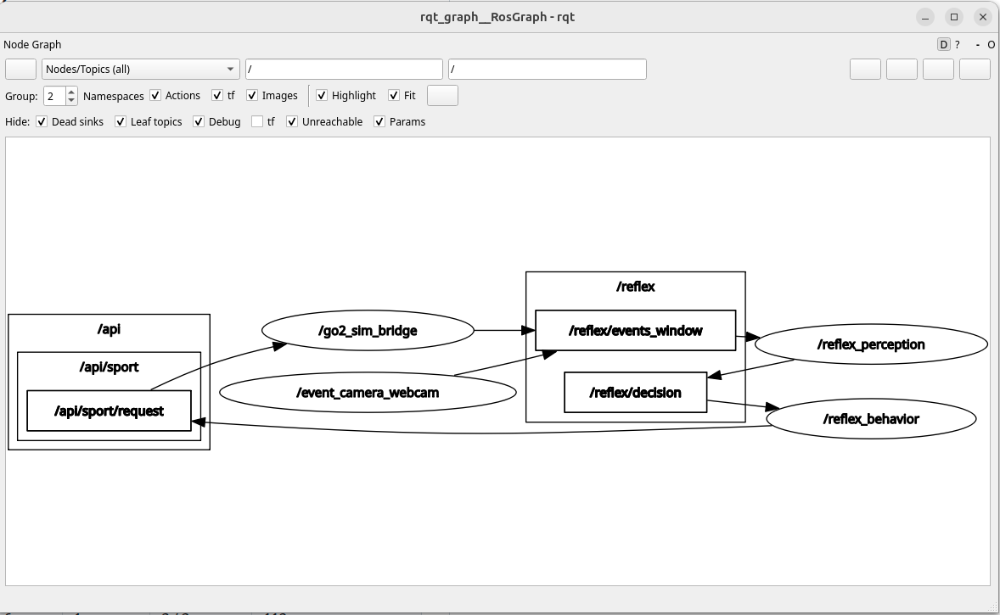

# hacklab2-durance-go2

Reflexes for a Unitree Go2 driven by an event camera and a spiking neural network (SNN).
Built for the Durance AI track of HackLab #2 (Berlin, 21–22 November 2026).

Pipeline: **events → SNN → reflex decision → Go2 sport-mode command over ROS 2**.

Main reflex: goalkeeper / dodge. The network classifies a fast-approaching object as
`none / left / center / right`; the dog either blocks it or steps out of the way.

## How it fits together

```
 EVENT SOURCE               PERCEPTION                  BEHAVIOR                    ROBOT
 simulator (MuJoCo)   ->    SNN  or                ->   state machine        ->     simulated Go2
 webcam stand-in            no-learning detector        + safety limits             (real Go2: same message)
 real event camera
        /reflex/events_window       /reflex/decision          /api/sport/request
        50 ms of events             none/left/center/right    Unitree sport-mode command
```

The same thing as drawn by `rqt_graph` with the camera side on a Kria and the robot side
on a PC:



Four boxes joined by three ROS 2 topics. Each box can be swapped without touching the
others: that is how the same code runs fully simulated on one PC, with the camera side on
a Kria board, and (the plan for the hackathon) with the real camera and the real dog.

Two loops around that pipeline:

- **Data and training**: simulate or record takes -> look at them -> train or fine-tune
  the SNN -> evaluate.
- **Running**: start an event source, perception, behavior and a robot.

## Status

Nothing has touched the real Go2, the real event camera or Durance's toolchain.

| Part | State |
|---|---|
| Event-camera emulator, MuJoCo scene with ball launcher and head camera | working, tested |
| Synthetic dataset with hard negatives (miss, crossing, slow, walker, idle) | working, tested |
| SNN (26.5k parameters, plain PyTorch) and training | trains in ~90 s; 81 % window accuracy on held-out simulated episodes |
| No-learning detector and reflex state machine | working, tested |
| Sport-mode `api_id` table, checked against Unitree's client | done, tested; not tried on a robot |
| Closed loop over ROS 2 in simulation | working; results below |
| Camera side on a Kria KV260 (Docker), webcam as stand-in event camera, PC as robot | working: 30 Hz, 6-13 ms to the PC |
| Recording, labelling and fine-tuning on recorded data | working with webcam takes; not yet with a real event camera |
| Optional walking (learned policy), keyboard and `/cmd_vel` driving | working in simulation |
| Camera adapter for the real sensor, SNN on the FPGA (RIVERLib), real Go2 | not started: blocked on hardware |

## Commands

Requires [pixi](https://pixi.sh). Two environments: the default one (Python, MuJoCo,
PyTorch) and `ros` (adds ROS 2 Humble), used as `pixi run -e ros ...`. A third one,
`kria`, is the light arm64 environment for the board.
Arguments after a `ros-*` command are `name:=value` pairs.

### Setup (once)

| Command | What it does |
|---|---|
| `pixi install -a` | Create both environments |
| `pixi run setup` | Fetch the Go2 MuJoCo model and Unitree's ROS 2 messages into `third_party/` |
| `pixi run -e ros ros-build` | Build the ROS 2 workspace. Again after changing messages or adding nodes |
| `pixi run test` | Unit tests (no ROS needed) |

### Look at the simulator (no ROS)

| Command | What it does |
|---|---|
| `pixi run view` | 3D window with balls rolling at the dog. Pose keys: X stand, C crouch, Q / E lean left / right, Z sit, H hello |
| `pixi run drive` | Same window, dog walks: arrows = speed and turn, A / D sidestep, SPACE stop |
| `pixi run sim` | Write `out/demo.mp4`: third person, dog-eye view, emulated events |

### Data and training

| Command | What it does |
|---|---|
| `pixi run gen-data` | 2000 simulated episodes -> `data/synth` (about 10 min, 63 MB) |
| `pixi run train` | Train the SNN on `data/synth` -> `out/models/snn.pt` |
| `pixi run eval` | SNN versus the no-learning detector on the same held-out windows |
| `pixi run view-data PATH` | Browse a dataset folder, or play an event recording. `--label left`, `--kind crossing`, `--sheet out/x.png` |
| `pixi run -e ros ros-record session:=NAME` | Record labelled takes from the live stream -> `data/real/NAME` |
| `pixi run build-real data/real/*` | Recorded takes -> training set `data/real_ds` (labels derived from the arrival mark) |
| `pixi run finetune-real --val-session NAME` | Build + fine-tune the SNN on recorded data -> `out/models/snn_real.pt` |

### Run the loop over ROS 2

| Command | What it does |
|---|---|
| `pixi run -e ros ros-sim` | Everything simulated: balls, perception, behavior, scoring. `detector:=snn\|simple`, `max_shots:=12`, `actuation_delay_ms:=300.0`, `record:=out/loop.mp4`, `locomotion:=rl reaction:=move` for real sidesteps |
| `pixi run -e ros ros-camera` | Camera side only: webcam as stand-in event camera + perception. `mirror:=true` |
| `pixi run -e ros ros-robot-sim` | Robot side only: behavior + simulated dog in a 3D window |
| `pixi run -e ros ros-drive` | Simulated dog driven by `/cmd_vel`, converted to the Go2's `Move` command |
| `pixi run -e ros ros-teleop` | Keyboard that publishes `/cmd_vel` (second terminal, with `ros-drive`) |
| `pixi run -e ros ros-tricks` | Keyboard for the Go2's built-in tricks (Hello, Sit, Stretch, dances; flips only with `allow_acrobatics:=true`). The simulator imitates Sit and Hello |
| `pixi run -e ros ros-shell` | Shell with ROS 2 ready, for `ros2 topic echo`, `rqt_graph`, ... |

Which command plays which part. The simulator can be the camera and the robot at once,
or the robot only:

| Command | Event source | Robot | Simulator publishes event windows? |
|---|---|---|---|
| `ros-sim` | simulator (balls rolled at the dog) | simulator | yes |
| `ros-camera` + `ros-robot-sim` | webcam on this PC | simulator | no, the webcam node does |
| Kria camera + `ros-robot-sim` | webcam on the Kria | simulator | no, the Kria does |
| `ros-drive` + `ros-teleop` | none (keyboard driving) | simulator, walking | no |
| at the hackathon | real event camera on the Kria | real Go2 | no simulator |

To watch the event stream of any of them, from `pixi run -e ros ros-shell`:

```bash
ros2 run rqt_image_view rqt_image_view /reflex/debug/events_image   # events as a picture
rqt_graph                                                           # nodes and topics
ros2 topic echo /reflex/decision                                    # what the detector says
```

More in `docs/inspecting-ros.md`.

### Keyboards

There are two, with different letters. One is the 3D window of the simulator, the other
is a terminal that sends ROS 2 requests (to the simulator or to the real robot).

| Action | 3D window (`view`, `drive`) | Terminal (`ros-tricks`) | In the simulator |
|---|---|---|---|
| Sit | `Z` | `s` | imitated |
| Stand up | `X` | `u` (RiseSit) | imitated |
| Hello (wave a paw) | `H` | `h` | imitated |
| Crouch, lean left / right | `C`, `Q`, `E` | – (reflexes, not tricks) | yes |
| Stretch, Content, Dance1, Dance2, Scrape, Heart | – | `t`, `c`, `1`, `2`, `p`, `e` | ignored with a warning; real robot only |
| Jumps and flips | – | `J`, `P`, `F`, `L`, `B`, only with `allow_acrobatics:=true` | ignored; real robot only |
| Stop, balance stand, recovery stand | – | `SPACE`, `b`, `r` | stand |
| Damp (emergency, the robot drops) | – | `!` | motors limp |
| Walk | arrows, `A`, `D` (`drive` only) | – (use `ros-teleop`) | yes, with the walking policy |

The 3D window cannot use `S` for sit: MuJoCo's viewer keeps it for shadows. To try the
tricks over ROS 2, run `pixi run -e ros ros-drive` in one terminal and
`pixi run -e ros ros-tricks` in another, and press the keys in the second.

### Kria board

| Command | What it does |
|---|---|
| `scripts/sync_kria.sh ubuntu@kria.local` | Copy the code to the board and build its Docker image |
| `ssh -t ubuntu@kria.local docker run --rm -it --net=host --device /dev/video0 reflex-kria` | Run the camera side on the board |
| `NO_DOCKER=1 scripts/sync_kria.sh ubuntu@kria.local` | Copy only, for the pixi route |
| on the board: `pixi install -e kria --frozen`, `pixi run -e kria kria-build`, `pixi run -e kria kria-camera` | Same camera side without Docker (`docs/real-robot.md`) |

### Optional extra

| Command | What it does |
|---|---|
| `bash scripts/setup_rl.sh` | Install unitree_rl_mjlab (to retrain the walking policy; the trained one is in `models/`) |
| `pixi run rl-play` | Watch the walking policy in its own simulator |

## Typical sessions

Everything simulated, one terminal:

```bash
pixi run -e ros ros-sim max_shots:=12 record:=out/loop.mp4
```

Camera on the Kria, robot simulated on the PC:

```bash
ssh -t ubuntu@kria.local docker run --rm -it --net=host --device /dev/video0 reflex-kria   # terminal 1
pixi run -e ros ros-robot-sim                                                             # terminal 2
```

Record real takes and fine-tune (camera side running as above):

```bash
pixi run -e ros ros-record session:=sat_am     # l / c / r / n start a take, SPACE = ball arrived
pixi run view-data data/real_ds                # after: pixi run build-real data/real/*
pixi run finetune-real --val-session sat_pm
pixi run -e ros ros-robot-sim                  # and the camera side with detector:=snn model:=out/models/snn_real.pt
```

## Documentation

| File | Contents |
|---|---|
| `docs/real-robot.md` | What is left before the real robot, first hour with it, the Kria rehearsal and its results |
| `docs/recording.md` | Recording takes, the labelling rule, fine-tuning |
| `docs/inspecting-ros.md` | Looking inside the running system: nodes, topics, message contents |
| `docs/go2-control.md` | Sport mode versus low-level control, the walking policy, MuJoCo versus MuJoCo Warp |
| `docs/questions-for-durance.md` | What to ask at the opening |
| `CLAUDE.md` | Rules and architecture notes for working on this repository with an agent |

## First results (simulation only)

4128 held-out windows from simulated episodes never seen in training:

| | No-learning detector | SNN |
|---|---|---|
| Missed threats | 93.5 % | 16.4 % |
| Wrong side | 1.8 % | 8.8 % |
| False alarms, all negatives | 1.1 % | 14.2 % |

The no-learning detector counts events in the lower part of the image. With the camera
shake we simulate, no threshold works: low enough to catch balls, it fires on everything
(at 100 events: 8 % missed, 81 % false alarms); high enough to stay quiet, it misses the
balls. The shake amplitude is a guess until we measure the real dog.

These are per-window numbers on emulated events. They say nothing yet about the real
camera, and the number that matters, correct reactions per ball through the state
machine, is not measured yet.

### Closed loop over ROS 2 (simulation only)

`pixi run -e ros ros-sim` starts three nodes: the MuJoCo bridge (publishes event
windows, listens on `/api/sport/request`), perception and behavior. One run, 12 shots
(9 balls, 3 hard negatives), same seed for every row, default sensor without camera shake:

| Detector | Actuation delay | Correct | Missed | Wrong side | False triggers | Median margin before arrival |
|---|---|---|---|---|---|---|
| SNN | 200 ms | 9 / 9 | 0 | 0 | 2 / 3 | 318 ms |
| SNN | 300 ms | 9 / 9 | 0 | 0 | 2 / 3 | 188 ms |
| SNN | 400 ms | 6 / 9 | 3 | 0 | 2 / 3 | 142 ms |
| No-learning | 300 ms | 2 / 9 | 6 | 1 | 3 / 3 | 112 ms |

Twelve shots is a smoke test, not a benchmark. The two SNN false triggers are both balls
crossing sideways. The actuation delay is the time the simulated dog waits before it
starts moving; 300 ms is a guess to be replaced by a measurement on the real Go2.
From newest event to request on the wire: about 6-10 ms of simulated time, with the
simulation running slower than real time, so this is not a latency claim.

## Other results

- Kria + webcam rehearsal: `docs/real-robot.md`.
- Walking policy, speed tracking and the closed loop with sidesteps: `docs/go2-control.md`.
