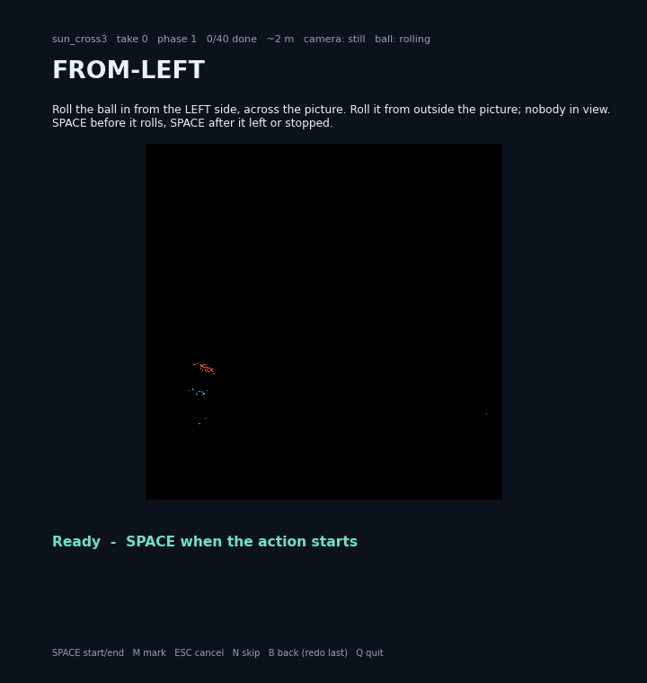
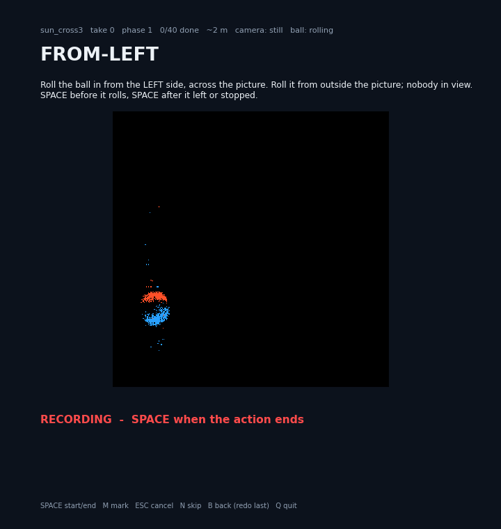
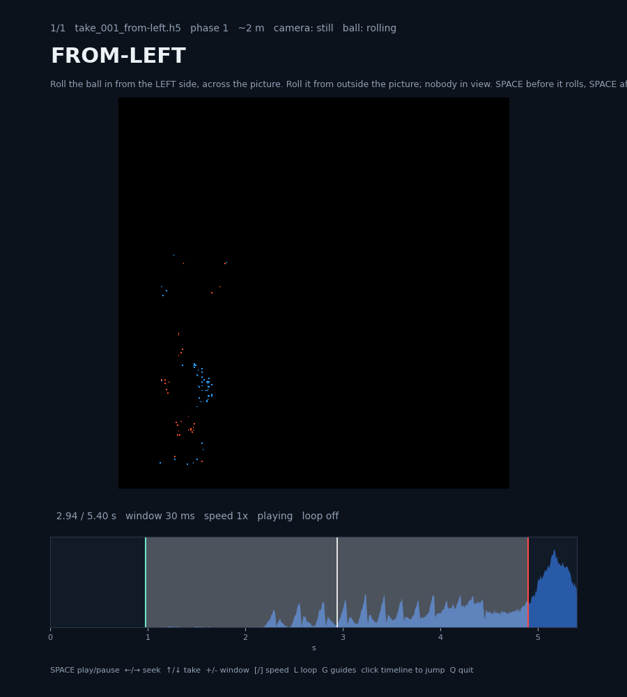

# capture: recording the real event camera

Tools to record, label, check and share data from the real Prophesee GenX320 on Durance's
Kria KV260, without ROS. The laptop starts the camera on the board over SSH, receives the raw
event stream, guides you through a list of takes and saves each one as a labelled HDF5 file.

| Waiting for the take | Recording | Replay |
|---|---|---|
|  |  |  |

## Quick start

Needs a Python environment with Durance's `river-tools` wheel and `h5py` (not pixi; the wheel
is proprietary and not in this repo), and the Kria's Ethernet port plugged into the laptop.
Run from the repository root.

```bash
ssh root@durance-kria.local despot_test_camera                # once after every boot of the board
python -m capture.record --session sun_cross3 --plan cross    # guided, labelled takes
python -m capture.replay data/river_samples/sun_cross3        # check them
python -m capture.summarize --plan-session sun_cross3         # what is recorded / missing
```

In the recorder: click into the window, then SPACE starts and ends a take, M marks a moment,
B redoes the last take, N skips, ESC cancels, Q quits. The same session name resumes later.

## The tools

| Module | Does |
|---|---|
| `record.py` | guided recording; plans `follow`, `cross`, `center` (a session remembers its plan in `plan.txt`); takes saved to `data/river_samples/<session>/` with `takes.csv` |
| `replay.py` | plays a session, a folder or files (`.h5`, river-tools `.bin`, Durance's gesture dataset) with label, marks and an event-rate timeline; `--snapshot` saves a frame |
| `relabel.py` | moves a take that showed something else to the right take of the plan |
| `summarize.py` | Markdown tables of all sessions, labels and missing takes |
| `bin_to_h5.py` | converts river-tools `.bin` recordings to HDF5 (verified read-back) |

File format (one HDF5 file per take: `/events/t, x, y, p` plus the label, instruction, start /
end marks as attributes) and reading code: `reflex/events/h5.py`.

## More

- `docs/recording-real-data.md`: setup (Windows and Linux), each session step by step, plans,
  tips from the first sessions, file format, troubleshooting, what is recorded so far.
- `docs/data-plan-follow.md`: what to record for following the ball, and why.
- `docs/durance-riversdk.md`: notes from Durance's docs (Kria, camera, FPGA deployment).

Recordings, the river-tools wheel and Durance's dataset stay out of git (`data/` is ignored).
Not done yet: turning these takes into training windows for the network.
