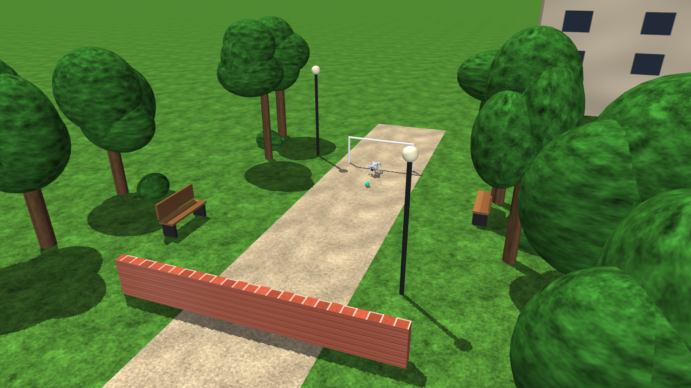

# Commands: what to run, where, and for what

Everything is started with `pixi run`. There are three families, and telling them apart
removes most of the confusion.

| Family | Looks like | Where | Uses ROS 2 | Visible in the web dashboard |
|---|---|---|---|---|
| Plain | `pixi run NAME` | PC or laptop | no | no |
| ROS | `pixi run -e ros ros-NAME` | PC or laptop | yes | yes |
| Kria | `pixi run -e kria kria-NAME` | the Kria board | yes | yes, from the PC |
| ROS on a Mac | `pixi run -e sim-arm ros-NAME` | arm64 Docker container on Apple Silicon | yes | yes, http://localhost:8080 |

- `-e ros` selects the environment that contains ROS 2. Without it, `ros2` does not exist.
- All commands are run from the repository folder (`hacklab2-durance-go2`).
- Arguments are written `name:=value` after the command (ROS family only).
- Stop anything with `Ctrl+C` in its terminal.
- ROS programs find each other on their own if they share a network and `ROS_DOMAIN_ID`
  (unset means 0, used everywhere here). Nothing has to be told an address.

## One-time setup

| Command | When |
|---|---|
| `pixi install -a` | after cloning; downloads the environments |
| `pixi run setup` | after cloning; fetches the Go2 model into `third_party/` |
| `pixi run -e ros ros-build` | after cloning, and after changing a message, a launch file or `setup.py` |
| `pixi run test` | any time; 73 tests, about 25 s |

Not in git, copy by hand to a new machine: `data/` (datasets and recordings).

The trained network is in git as `models/snn.pt` (with `models/snn.json`, its metrics on
simulated data). Commands default to `out/models/snn.pt`, where `pixi run train` writes;
on a new machine either `mkdir -p out/models && cp models/snn.* out/models/`, or pass
`model:=models/snn.pt`.

## Plain commands (no ROS)

| Command | What it does | Opens |
|---|---|---|
| `pixi run view` | balls rolled at a standing dog; you trigger postures | 3D window |
| `pixi run drive` | walk the dog with the arrow keys | 3D window |
| `pixi run sim` | records `out/demo.mp4`: RGB and emulated events side by side | nothing |
| `pixi run gen-data` | synthetic dataset into `data/synth` | nothing |
| `pixi run train` | trains the network into `out/models/snn.pt` | nothing |
| `pixi run eval` | network versus simple detector on held-out windows | nothing |
| `pixi run view-data PATH` | browse a dataset folder or a recording | window; `--sheet`, `--video` save files |
| `pixi run build-real data/real/*` | recorded sessions into a training set, `data/real_ds` | nothing |
| `pixi run finetune-real` | the previous step, then fine-tune into `out/models/snn_real.pt` | nothing |
| `pixi run rl-play` | watch the walking policy inside mjlab (optional extra) | 3D window; `--viewer viser` for the browser |

Keys, pressed in the 3D window: `X` stand, `C` crouch, `Q` / `E` lean, `Z` sit, `H` hello.
With `drive`: arrows, `A` / `D` sideways, `SPACE` stop.

## ROS commands on the PC

Two kinds: **launchers** start part of the pipeline, **tools** attach to whatever is running.

### Launchers (pick one)

| Command | Camera | Detector | Behavior | Robot |
|---|---|---|---|---|
| `ros-sim` | simulated | yes | yes | simulated, with balls and a score |
| `ros-camera` | webcam on this machine | yes | no | no |
| `ros-robot-sim` | no | no | yes | simulated, waits for decisions |
| `ros-drive` | no | no | no | simulated, walks on `/cmd_vel` |
| `ros-drive camera:=true` | simulated, moves with the dog | yes | no | simulated, walks on `/cmd_vel` |
| `ros-follow-sim` | simulated, moves with the dog, a ball rolled by script | target node (centroid) | `ros-follow` (or `follow:=true`) | simulated, walks |
| `ros-events-sim` | GenX320 recordings, or the live KV260 camera | target node, or the ball SNN with `tracker:=snn` (or simple detector) | follow node, enabled (or reflex) | simulated, walks |

Only `ros-sim` is complete on its own. The others do nothing visible until their partner runs:

| If you start | It does nothing until you also start | Why |
|---|---|---|
| `ros-sim` | nothing else needed | camera, detector, behavior and robot are all inside |
| `ros-robot-sim` | a camera: `kria-camera` on the Kria, or `ros-camera` on a PC with a webcam | the dog waits for decisions on `/reflex/decision` |
| `ros-camera` / `kria-camera` | a robot: `ros-robot-sim` (or the real Go2 with the behavior node) | decisions are published but nobody acts on them |
| `ros-drive` | a keyboard: `ros-teleop` (walking) and/or `ros-tricks` (Hello, Sit) | the dog stands still until something publishes `/cmd_vel` or a trick |
| `ros-follow-sim` | `ros-follow`, then press `f` (or start it with `follow:=true`) | the follow node starts disabled, on purpose |
| `ros-events-sim source:=live` | the camera sender on the board (`kria_host:=...` starts it) | no events until `despot_debug_camera` connects; with a recording nothing else is needed |

`ros-web` can be added to any of them; it never replaces a partner.

Arguments (defaults in brackets):

- `ros-sim`: `detector:=snn|simple` [snn], `max_shots:=N` [0, endless], `negative_fraction:=0.3`,
  `actuation_delay_ms:=70.0`, `record:=out/x.mp4`, `mode:=keeper|dodge`,
  `reaction:=euler|move`, `locomotion:=none|rl`, `move_vy:=0.3`, `hold_s:=0.6`,
  `shot_period_s:=3.0`, `seed:=0`, `randomize:=false`, `viewer:=false` (true: also open the
  MuJoCo window; by default it runs with no window and you watch it with `ros-web`).
- `ros-camera`: `device:=0` (camera number), `detector:=simple|snn` [simple], `mirror:=false`,
  `fps:=30.0`, `contrast_threshold:=0.25`, `calibrate_s:=3.0`.
- `ros-robot-sim`: `viewer:=true` (false: no MuJoCo window), `reaction:=euler|move`,
  `locomotion:=none|rl`, `actuation_delay_ms:=70.0`, `enabled:=true` (false: only log
  what it would send), `min_confidence:=0.6`, `consecutive:=2`.
- `ros-drive`: `viewer:=true`, `actuation_delay_ms:=70.0`, `timeout_s:=0.0`,
  `camera:=false` (true: the dog's simulated event camera and the detector run while you
  drive), and with the camera `detector:=snn|simple` [snn].

- `ros-follow-sim`: `follow:=false` (true: the follow node runs inside and starts by itself),
  `mode:=walk|gaze|look`, `vfov_deg:=60.0`, `viewer:=true`, `actuation_delay_ms:=300.0`, `target_start_s:=5.0` (the
  ball waits this long so the target node can calibrate), `zone_top:=0.3`. Details:
  `docs/follow.md`.
- `ros-events-sim`: `source:=PATH[,PATH]|live` [data/river], `behavior:=follow|reflex`,
  `speed:=1.0`, `loop:=true`, `gap_s:=1.0`, `still_first:=true` (the session's still scene
  plays first, for calibration), `exclude:='*take_002*'`, `flip_x:=false`, `flip_y:=false`,
  live: `port:=3333`, `kria_host:=root@durance-kria.local`; follow: `follow:=true`,
  `mode:=walk|gaze|look`, `hfov_deg:=90.0`, `vfov_deg:=90.0`, `camera_on_trunk:=false` (look
  mode; open loop), `zone_top:=0.3`, `min_events:=0.0`, `tracker:=centroid|snn`; snn: `ball_model:=out/models/ball_small_best.pt`, `ball_min_p:=0.55`,
  `ball_min_pixels:=20`, `fullres_ms:=20.0`; reflex:
  `reaction:=euler|move`, `min_confidence:=0.6`; robot: `viewer:=true`, `scene:=lab`,
  `actuation_delay_ms` [300 walking, 70 reflex]. Details: `docs/events-sim.md`.

Scenery: `ros-sim`, `ros-robot-sim` and `ros-drive` take `scene:=lab|park` [lab]. `park` is
an outdoor scene built from code (grass, a gravel path, trees, benches, a brick wall, houses);
see `reflex/sim/scenery.py`. Give `ros-web` the same value (`ros-web scene:=park`) or it draws
the lab. The browser shows the same textures, but with its own lighting and no shadows, so it
does not look identical to MuJoCo. The plain commands take it as `--scene park` (`pixi run view --scene park`, also
`drive` and `sim`). The network was trained on the lab scene only: in the park it scored
5 of 9 balls where the lab gave 9 of 9 (one run of 12 shots each), so the README numbers
are lab numbers.



### Tools (add as many as you want, each in its own terminal)

| Command | What it does | Keys go to |
|---|---|---|
| `ros-web` | dashboard at `http://localhost:8080`; `port:=8081` | the browser |
| `ros-teleop` | keyboard to `/cmd_vel`; needs `ros-drive` | its terminal: `i` forward, `,` back, `j` / `l` turn, `J` / `L` sideways, `k` stop |
| `ros-tricks` | keyboard to built-in tricks; `allow_acrobatics:=true` | its terminal: `h` Hello, `s` Sit, `u` RiseSit, `!` Damp |
| `ros-follow` | follow node: `/reflex/target` to Move / StopMove (or Euler with `mode:=gaze` / `mode:=look`); starts disabled. `max_vx:=0.3`, `max_wz:=0.5`, `max_travel_m:=3.0`, `dry_run:=true` | its terminal: `f` start, `SPACE` stop, `!` Damp, `q` quit |
| `ros-look` | follow node in look mode: nine trunk gestures (Euler yaw + pitch), never walks; starts disabled. `look_yaw:=0.3`, `look_pitch:=0.2`, `camera_on_trunk:=true`, `invert_pitch:=false`, `dry_run:=true` (`docs/follow.md`) | its terminal: `f` start, `SPACE` stop, `1`-`9` a gesture (numpad layout), `!` Damp, `q` quit |
| `ros-event-camera` | event camera node alone, onto `/reflex/events_window`: `source:=PATH` (replay) or `source:=live`; same arguments as `ros-events-sim` | — |
| `ros-target` | target node alone: `/reflex/events_window` to `/reflex/target`; `zone_top:=0.0` for a drone | — |
| `ros-record session:=NAME` | record labelled takes from the live stream | its terminal: `l` `c` `r` `n` start, `SPACE` hit, `x` cancel, `u` undo, `q` quit |
| `ros-shell` | a shell where `ros2` and `rqt` work | — |

Inside `ros-shell`:

```bash
ros2 node list
ros2 topic list
ros2 topic echo /reflex/decision
ros2 topic hz /reflex/events_window
rqt_graph
ros2 run rqt_image_view rqt_image_view /reflex/debug/events_image
ros2 service call /reflex/recalibrate std_srvs/srv/Trigger     # simple detector only
ros2 topic echo /reflex/target                                  # where the target is (u, v, confidence)
ros2 topic echo /reflex/debug/follow                            # follow node: state, burst, travel
ros2 service call /reflex/follow/enable std_srvs/srv/SetBool "{data: false}"   # stop following
ros2 service call /reflex/target/recalibrate std_srvs/srv/Trigger
```

## Simulation on a Mac (Apple Silicon)

`default` and `ros` are `linux-64` only (PyTorch with CUDA). Under amd64 emulation (QEMU) in
Docker on a Mac, `sim_bridge` and `web_viewer` grow to the whole VM's memory and get
OOM-killed (seen 21 Nov 2026: ~7 GB each; building the lab scene natively takes ~270 MB).
`sim-arm` runs natively in an arm64 container: ROS 2, MuJoCo, the walking policy, the web
dashboard and PyTorch on the CPU (conda-forge's `cpu` build; the PyPI wheel for arm64 Linux
pulls in CUDA). So `ros-sim detector:=snn` works, and so do `test`, `gen-data`, `train` and
`eval`, slower than on the PC's GPU, and `ros-events-sim tracker:=snn` (the ball SNN,
`docs/events-sim.md`; also needs `riverops-0/` and `Training/`). The reflex SNN still does
not fit `ros-events-sim`: it expects 320x180 windows, not the camera's 320x320.
No GLFW windows: use `viewer:=false` and `ros-web`.

```bash
# on the Mac, from the repository folder
docker run -it --platform linux/arm64 --name go2arm \
  -v "$PWD":/ws -v go2arm-cache:/root/.cache -w /ws -p 8080:8080 \
  ghcr.io/prefix-dev/pixi:latest bash

# inside the container, once
pixi config set --global detached-environments true    # env in the volume, not in /ws/.pixi
apt-get update && apt-get install -y git libegl1 libegl-mesa0 libgl1-mesa-dri libglib2.0-0
bash scripts/setup.sh                                   # if third_party/ is missing (`pixi run setup` needs default)
rm -rf ros2_ws/build ros2_ws/install ros2_ws/log        # drop an amd64 build, if any
pixi run -e sim-arm ros-build

# then
pixi run -e sim-arm ros-events-sim source:=data/river/sat_follow2 viewer:=false
pixi run -e sim-arm ros-web          # second shell: docker exec -it go2arm bash
```

Later: `docker start -ai go2arm`. DDS stays inside the container; the real Go2 and the Kria
cannot be reached from Docker on macOS.

## On the Kria

Reach it with `ssh ubuntu@kria.local`. pixi is at `~/.pixi/bin/pixi` (not on the PATH).

| Command, run on the board | What it does |
|---|---|
| `~/.pixi/bin/pixi run --frozen -e kria kria-build` | build the workspace (after copying new code) |
| `~/.pixi/bin/pixi run --frozen -e kria kria-camera` | webcam as event camera + detector; same arguments as `ros-camera` |
| `~/.pixi/bin/pixi run --frozen -e kria kria-event-camera` | the real event camera onto `/reflex/events_window`; start `despot_debug_camera --host 127.0.0.1 --port 3333` first. Untested |
| `~/.pixi/bin/pixi run --frozen -e kria kria-shell` | a shell where `ros2` works |

`--frozen` makes pixi use the lock file as it is. Always pass it on the board: its pixi is
newer than the PC's, and without the flag it may try to rewrite the lock file.

Without logging in first, straight from a PC terminal (`-t` so that `Ctrl+C` reaches the board):

```bash
ssh -t ubuntu@kria.local 'cd hacklab2-durance-go2 && ~/.pixi/bin/pixi run --frozen -e kria kria-camera'
```

From the PC: `bash scripts/sync_kria.sh` copies the code to the board and rebuilds the
Docker image; `NO_DOCKER=1 bash scripts/sync_kria.sh` copies only (then `kria-build`).
The Docker route is in `docs/real-robot.md`.

## Recipes

Each line is one terminal.

**See the whole loop work, with a score**
```bash
pixi run -e ros ros-sim
pixi run -e ros ros-web            # optional
```

**Compare the network with the simple detector**
```bash
pixi run -e ros ros-sim detector:=snn max_shots:=10
pixi run -e ros ros-sim detector:=simple max_shots:=10     # afterwards, not at once
```

**Kria as the camera, simulated dog on the PC** (the rehearsal for Saturday)
```bash
~/.pixi/bin/pixi run --frozen -e kria kria-camera     # on the Kria
pixi run -e ros ros-robot-sim                # on the PC
pixi run -e ros ros-web                      # on the PC, optional
```

**Watch the simulated dog follow the recorded ball** (`docs/events-sim.md`)
```bash
pixi run -e ros ros-events-sim source:=data/river/sat_follow2 exclude:='*take_002*'
pixi run -e ros ros-web                      # optional: the events next to the dog
```

**Live KV260 event camera, simulated dog**
```bash
pixi run -e ros ros-events-sim source:=live kria_host:=root@durance-kria.local
```

**Webcam on the PC as the camera** (needs a camera plugged into the PC)
```bash
pixi run -e ros ros-camera
pixi run -e ros ros-robot-sim
```

**Drive the dog and watch it in the browser**
```bash
pixi run -e ros ros-drive viewer:=false
pixi run -e ros ros-teleop
pixi run -e ros ros-web
```

**Tricks**
```bash
pixi run -e ros ros-drive
pixi run -e ros ros-tricks
```

**Record data, then fine-tune**
```bash
~/.pixi/bin/pixi run --frozen -e kria kria-camera     # or any other camera source
pixi run -e ros ros-record session:=sat_am
pixi run -e ros ros-record session:=sat_pm   # later, a second session
pixi run finetune-real --val-session sat_pm
```

**Retrain from scratch on synthetic data**
```bash
pixi run gen-data && pixi run train && pixi run eval
```

**Drive the dog and watch its event camera** (what the sensor sees when the dog itself moves)
```bash
pixi run -e ros ros-drive camera:=true       # add viewer:=false to skip the MuJoCo window
pixi run -e ros ros-teleop
pixi run -e ros ros-web                      # events, decision and network activity
```
The same in the park, which gives the camera much more to see:
```bash
pixi run -e ros ros-drive camera:=true scene:=park
pixi run -e ros ros-teleop
pixi run -e ros ros-web scene:=park
```
Nothing acts on the decisions here: there is no behavior node. Expect false alarms while
walking (measured: about 15 % of windows, none standing still): the network was trained
with a still dog, and a moving camera makes the whole scene produce events. With the
camera on, the simulation runs at about 70 % of real time.

## When something does not work

| Symptom | Cause |
|---|---|
| the dog reacts to nothing you did, shots are scored oddly, latency shows absurd numbers | two launchers running at once (e.g. `ros-sim` while `ros-drive` is still open): they share topics. Stop one, or give one of them another network: `ROS_DOMAIN_ID=7 pixi run -e ros ros-sim` |
| `ros2: command not found`, `pixi: command not found` on the Kria | not inside `ros-shell`; on the Kria use `~/.pixi/bin/pixi` and `-e kria` |
| `cannot open camera 0` | no camera on that machine, or another number: `device:=2` |
| the dog does not react | no camera source running; simple detector calibrated while something moved (call `/reflex/recalibrate`); reflexes `enabled:=false` |
| recorder says "no windows yet" | no camera source running, or a different `ROS_DOMAIN_ID` |
| the web dashboard does not move | the simulator was started with a plain command (`pixi run view` / `drive`); use the `ros-` one |
| dashboard on port 8081 | another dashboard is still running on 8080 |
| keys do nothing | `ros-teleop`, `ros-tricks`, `ros-record`: their terminal must have focus; `view` / `drive`: the 3D window must |
| `event_camera`: `Address already in use` | `river-tools capture` (or another event camera node) holds port 3333; stop it or pass `port:=3334` |
| `event_camera`: `No module named 'h5py'` | the environment predates h5py in `pixi.toml`: `pixi install -a` (on the Kria, replay needs it too; live does not) |
| nodes on two machines do not see each other | different network or `ROS_DOMAIN_ID`; check with `ros2 node list` on both |
