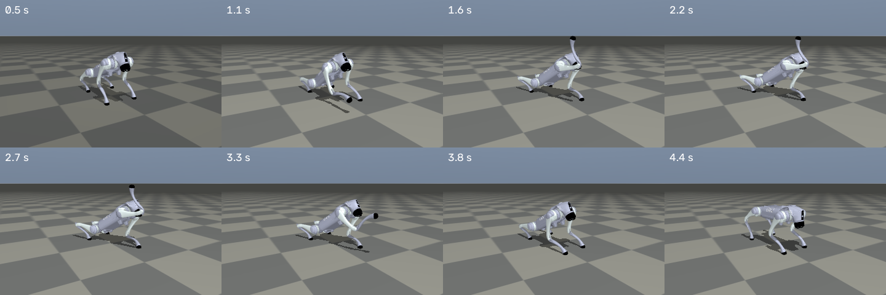

# Controlling the Go2

Notes on how the robot is commanded and how our simulation relates to it. Statements
marked **unverified** have not been checked against a real robot or an official source.

## Two ways to control the robot

| | High level: sport mode | Low level: motor control |
|---|---|---|
| You send | A behavior: "move at 0.3 m/s", "stand down" | A target for each of the 12 motors, at about 500 Hz |
| Balance and gait | Unitree's controller | Yours |
| ROS 2 topic | `/api/sport/request` | `/lowcmd` |
| Message | `unitree_api/msg/Request` (`api_id` + JSON parameters) | `unitree_go/msg/LowCmd` (position, velocity, torque, gains per motor) |
| Feedback | `sportmodestate` | `lowstate` (also `lf/lowstate` at low frequency) |
| Example in `unitree_ros2` | `example/src/sport_mode_ctrl.cpp` | `example/src/low_level_ctrl.cpp` |

Topic and message names above were read from `unitree_ros2` at commit `668d1ec`.

Before using low-level control, sport mode has to be switched off so the two controllers
do not fight over the motors. The exact procedure for the Go2 at the hackathon is
**unverified**; ask before trying.

### Why this project uses sport mode

- **Time.** Low level means writing or training a controller that keeps the dog upright
  and moves it. That does not fit in 30 hours next to the camera, the SNN and the FPGA.
- **The track is about perception**, not locomotion. Sport mode gives the motion for free.
- **Safety.** A low-level bug can drop the robot or strain a motor. The robot is borrowed
  and shared.
- **Reliable demo.** Unitree's motions are tested; ours would not be.

### What sport mode costs: reaction time

Sport mode adds its own latency and ramps. Measured on the real Go2 on 21 Nov 2026 (`docs/real-robot.md`): a
lean starts about 70 ms after the command and is 90 % done at about 270 ms; a Move starts
within about 50 ms but covers only 3 cm in the first 300 ms. A lean barely moves the trunk sideways (under 1 cm):
it tilts the dog, it does not take it out of a ball's path. The simulator's lean and its
70 ms default delay are fitted to these measurements. A
low-level "flinch" could start within tens of milliseconds, which would look much more
like a reflex. The camera and the SNN react in milliseconds, so the dog may be the
bottleneck.

How the plan deals with it:

1. Measure the real command-to-motion delay before deciding anything.
2. If a lateral step is slow, use posture commands (`Euler`), which should start sooner.
3. In the pitch, report perception latency separately from robot latency.

Middle path worth keeping in mind: stay in sport mode for everything, and if time and the
organizers allow it, try one single low-level gesture with the robot secured. Our
simulation already does exactly that (joint PD control), so starting code exists in
`reflex/sim/scene.py`.

## Sport-mode commands

The verified table lives in `reflex/runtime/sport_api.py`, with a test that compares it
to Unitree's header. Commands used or likely to be used:

| Command | `api_id` | Use |
|---|---|---|
| `Damp` | 1001 | Motors go limp: emergency stop |
| `BalanceStand` | 1002 | Stand, ready to move |
| `StopMove` | 1003 | Stop the current motion |
| `StandUp` / `StandDown` | 1004 / 1005 | Get up, lie down |
| `RecoveryStand` | 1006 | Get up after a fall |
| `Euler` | 1007 | Lean the trunk (roll, pitch, yaw) |
| `Move` | 1008 | Walk (vx, vy, vyaw) |
| `Pose` | 1028 | Posture mode on/off; Euler only acts with it on (real Go2, 21 Nov) |
| `Hello` | 1016 | Wave |

### Tricks

Sit, Hello, Stretch, dances, jumps and flips are sport-mode commands too: the real robot
already knows them and each is one request with its own `api_id`. They are in
`reflex/runtime/sport_api.py`, read from Unitree's header at the same commit:

| Group | Commands |
|---|---|
| Gestures | `Sit` 1009, `RiseSit` 1010, `Hello` 1016, `Stretch` 1017, `Content` 1020, `Dance1` 1022, `Dance2` 1023, `Scrape` 1029, `Heart` 1036 |
| Acrobatics | `FrontFlip` 1030, `FrontJump` 1031, `FrontPounce` 1032, `LeftFlip` 2041, `BackFlip` 2043 |

Left out: `HandStand` 2044 and `WalkUpright` (they take a flag). Which of these the Go2 X
at the hackathon accepts, and which the organizers allow, is not known.

```bash
pixi run -e ros ros-tricks                          # keyboard: h Hello, s Sit, u RiseSit, t Stretch, ...
pixi run -e ros ros-tricks allow_acrobatics:=true   # also J/P/F/L/B: jumps and flips
```

Acrobatics are refused unless enabled, use capital letters, and need a clear area.

**In the simulator** nothing executes these: the movements live in Unitree's closed
controller inside the robot. We imitate three of them with slow, statically stable joint
sequences (`MOTIONS` in `reflex/sim/scene.py`): `Sit`, `RiseSit` and `Hello` (sit, raise
the front-right paw, wave three times, stand up; 4.5 s). The rest is ignored with a
warning. Ours do not look or last like Unitree's; they exist to make the simulated demo
livelier and to test that the right request goes out. In `pixi run view` / `drive`: Z
sits, H says hello, X stands up.



Tried and dropped: sitting up with both front paws in the air. Across 72 combinations
of joint angles the trunk always fell forward: with the front paws off the ground the
centre of mass is ahead of the rump. Balancing on the hind legs, like jumps and flips,
needs a learned controller, not a posture.

There is no `BodyHeight` command in the client at this commit.

## Simulation: what we have and what is on the radar

### What we use now

Plain MuJoCo with the Go2 model from MuJoCo Menagerie. The dog holds one of four
hand-picked poses (`stand`, `crouch`, `lean_left`, `lean_right`) through a joint PD
controller. It does not walk. A bridge node will accept sport-mode requests and translate
them into those poses, so the behavior node publishes the same message to the simulator
and to the robot.

This validates message format, reflex logic, safety limits and rough timing. It does not
validate how the real Go2 moves.

### On the radar: `unitree_mujoco`

https://github.com/unitreerobotics/unitree_mujoco is Unitree's own simulator, built on
MuJoCo and `unitree_sdk2`.

- **Closer to the real robot at low level.** The simulated robot speaks the same DDS
  topics as the real one (`lowcmd`, `lowstate`), so a low-level controller can move from
  simulation to robot unchanged.
- **Not closer at high level.** It does not implement sport mode, so `Move`, `StandDown`
  and the rest do nothing there. Our bridge would still be needed.
- **Heavier to set up.** It needs `unitree_sdk2` built and DDS configured, and has no event
  camera or ball launcher.

Not installed or tried here; the points above come from its documentation.

Switch to it if we decide to do low-level control on the real robot: that is the case it
was built for. For the sport-mode plan it adds setup cost without adding fidelity.

### Optional: a dog that walks in simulation (`unitree_rl_mjlab`)

A dog that actually walks in simulation needs a locomotion policy. Unitree's
https://github.com/unitreerobotics/unitree_rl_mjlab trains one with reinforcement
learning (PPO, 4096 parallel robots on the GPU). It ships no pretrained Go2 policy, so it
has to be trained: `scripts/setup_rl.sh` installs it and prints the training command.

Trained here on 18-19 Nov 2026 (RTX 5090): the default 10001 iterations at about 0.61 s
each. Result: episodes reach the maximum length (the dog no longer falls), reward for
tracking linear velocity 0.57 and angular velocity 0.92. Whether fewer iterations would
do is not known; only the final checkpoint was looked at.

```bash
bash scripts/setup_rl.sh     # clone and install into third_party/unitree_rl_mjlab/.venv
cd third_party/unitree_rl_mjlab
WANDB_MODE=disabled MUJOCO_GL=egl nohup .venv/bin/python scripts/train.py Unitree-Go2-Flat \
    --env.scene.num-envs=4096 > train.log 2>&1 &
cd ../.. && pixi run rl-play           # watch the newest checkpoint; --num_envs 9, --viewer viser
```

Checkpoints and the exported `policy.onnx` land in
`third_party/unitree_rl_mjlab/logs/rsl_rl/go2_velocity/<date>/` (git-ignored).

`rl-play` opens mjlab's own viewer on MuJoCo Warp (physics on the GPU), with the
repository's own Go2 model. It is a separate world from `pixi run view`: no balls, no
event camera. The environment gives the dog random velocity commands; the arrow above it
shows the current one. Closing the window does not stop the process: Ctrl+C in the
terminal, or `pkill -f scripts/play.py`.

The trained policy (from `deploy/robots/go2/config/policy/velocity/v0/params/deploy.yaml`):

- Runs at 50 Hz. Input, 47 numbers: base angular velocity (3), projected gravity (3),
  velocity command vx, vy, yaw rate (3), gait phase (2), joint positions relative to
  default (12), joint velocities (12), previous action (12).
- Output, 12 numbers: joint position targets = default pose + 0.25 x action, tracked by a
  PD controller with gains 20/20/40 and damping 1/1/2 (abduction/hip/knee).
- Command ranges: vx -0.5..1.0 m/s, vy -0.5..0.5 m/s, yaw rate -1..1 rad/s.

#### Walking inside our simulator (optional mode)

Integrated on 19 Nov 2026 as an addition: nothing changes unless it is switched on. The
postures (stand, crouch, lean) and every earlier result are untouched.

- `models/go2_walk.onnx` is the exported policy (764 kB, in git), with its provenance and
  interface in `models/go2_walk.json`.
- `reflex/sim/locomotion.py` runs it with onnxruntime at 50 Hz and builds its observation.
- `Go2Sim.enable_walking()` loads it; `set_velocity(vx, vy, wz)` walks; `set_pose(name)`
  returns to postures. The dog has two modes, `pose` and `walk`.
- We kept the Menagerie model. In `walk` mode the simulator sets joint damping and
  friction loss to zero, uses the policy's gains and the training contact model; in
  `pose` mode it restores everything.

Three ways to use it:

| Command | What it does |
|---|---|
| `pixi run drive` | 3D window, no ROS. UP/DOWN faster/slower, LEFT/RIGHT turn, A/D sidestep, SPACE stop, plus the pose keys X stand, C crouch, Q/E lean left/right. Each press adds speed (the viewer does not report key releases) |
| `pixi run -e ros ros-drive` and, in a second terminal, `pixi run -e ros ros-teleop` | The same over ROS 2: keyboard -> `/cmd_vel` -> `cmd_vel_to_sport` -> `Move` on `/api/sport/request` -> walking dog. `cmd_vel_to_sport` is robot-agnostic: run alone, it would drive a real Go2 in sport mode (not tried) |
| `pixi run -e ros ros-sim locomotion:=rl reaction:=move move_vy:=0.5 hold_s:=1.0` | Closed loop where the reflex is a real sidestep. Between shots the simulator walks the dog back to its spot using ground truth |

Measured in our simulator (MuJoCo on the CPU, a different engine from the one it was
trained in). It never fell in these runs, including starting to walk from the crouch.
Steady speed over 4 s, after 2 s to get going:

| Command | Measured | Before the contact fix |
|---|---|---|
| forward 0.5 m/s | 0.47 (93 %) | 0.36 (73 %) |
| forward 1.0 m/s | 0.91 (91 %) | 0.86 (86 %) |
| backward 0.4 m/s | 0.30 (76 %) | 0.27 (67 %) |
| sideways 0.4 m/s | 0.26 (65 %) | 0.19 (47 %) |
| turn 0.8 rad/s | 0.72 (90 %) | 0.47 (59 %) |

The contact fix: the Menagerie model uses an elliptic friction cone with `impratio` 100;
training used MuJoCo's defaults (pyramidal cone, `impratio` 1). Tested one setting at a
time, the time step and the calf rotor inertia made no difference and the contact model
explained the shortfall. `Go2Sim` now switches to the training contact model in `walk`
mode and back in `pose` mode. Sideways and backward stay below the command; that part
is probably the policy itself (not verified against its own simulator).

Closed loop with sidesteps (SNN, 300 ms actuation delay), two runs of 12 shots:

| Run | Balls | Correct side | Wrong side | Missed | Negatives that triggered |
|---|---|---|---|---|---|
| Before the contact fix | 9 | 8 | 1 | 0 | 3 of 3 (balls that miss) |
| After the contact fix | 12 | 11 | 1 | 0 | none drawn in this run |

The shots differ between runs (the random sequence depends on timing), and 12 is too
few to conclude anything; the second run says nothing about false triggers. After
walking back, the dog stands within 6 cm and 3.4 degrees of its spot, not exactly on it.

#### MuJoCo and MuJoCo Warp

The policy was trained in MuJoCo Warp and runs here in regular MuJoCo. They are the same
simulator in two implementations:

| | MuJoCo | MuJoCo Warp |
|---|---|---|
| Runs on | CPU | NVIDIA GPU |
| Built for | one robot, or a few | thousands of robots in parallel |
| Typical use | control, visualization, tests, debugging | reinforcement-learning training |
| Features | all | a subset; newer and still changing |
| Version here | 4.0.1 (pixi environment) | mujoco-warp with MuJoCo 3.5.0 (`third_party/unitree_rl_mjlab/.venv`) |

Same model files and equations, small numerical and solver differences. Training used
4096 dogs at once on the GPU; our simulator has one dog and spends most of its time
rendering the camera, so the CPU version is the right one for it. That the policy walks
in both is a (weak) sign it is not tied to one engine. The "subset" and single-robot
speed statements come from general knowledge of the two, not from measurements here.

#### Its Go2 model versus the Menagerie one

Compared by loading both files in MuJoCo (19 Nov 2026). The robot is the same: total
mass 15.206 kg, same bodies and inertias, same 12 joints in the same order (FL, FR, RL,
RR; hip, thigh, calf), same joint limits, same meshes, same 23 collision shapes. The
`unitree_rl_mjlab` file looks like the Menagerie file with the control parts stripped
out, which its Python code then adds back differently:

| | Menagerie `go2.xml` (our simulator) | `unitree_rl_mjlab` |
|---|---|---|
| Actuators in the XML | 12 torque motors, limits 23.7 / 23.7 / 45.43 N·m | none; position actuators added in Python, limits 23.5 / 23.5 / 45 N·m |
| Joint control | our own PD in `Go2Sim`: kp 60, kd 3 | kp 20 / 20 / 40, kd 1 / 1 / 2 |
| Joint damping, friction loss | 2.0 and 0.2 on every joint | 0 and 0 |
| Rotor inertia (armature) | 0.01 | 0.01, calf 0.02 |
| Foot friction | 0.6 | 1.0 in the XML, set to 0.6 by its config |
| Friction cone | elliptic | pyramidal |
| Sensors | none | IMU (angular velocity, linear velocity, acceleration) |
| Standing pose | keyframe: hips 0, thigh 0.9, calf -1.8, base at 0.27 m | hips +-0.1, thigh 0.9, calf -1.8, base at 0.32 m |
| Physics engine | MuJoCo on the CPU | MuJoCo Warp on the GPU |

What this means for running the policy in our simulator: the body matches, but the policy
learned with soft gains and joints without passive damping. Putting it on the Menagerie
model as it is (damping 2.0, our kp 60) would change how the legs respond, and the walk
may degrade or fail. The safer route is to load its `go2.xml` and reproduce its gains.
Not tried.

This policy is low-level control: on a real robot it replaces sport mode. We do not plan
to deploy it; it only makes the simulated dog respond to `Move` like the real one would.
