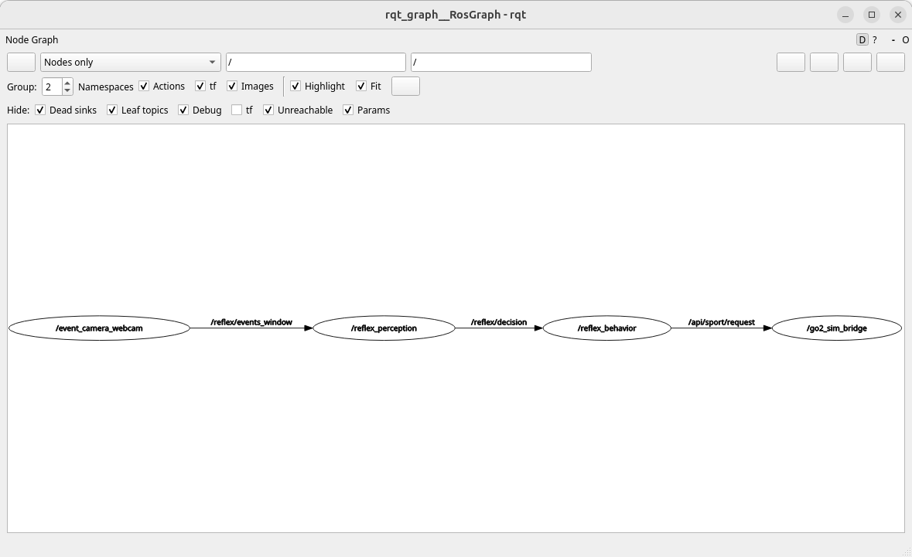
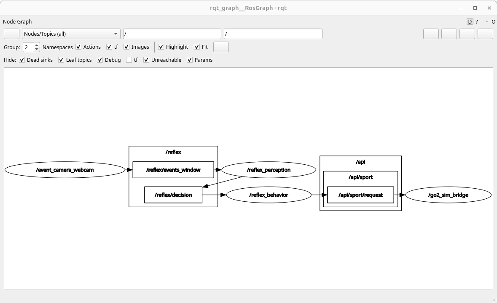
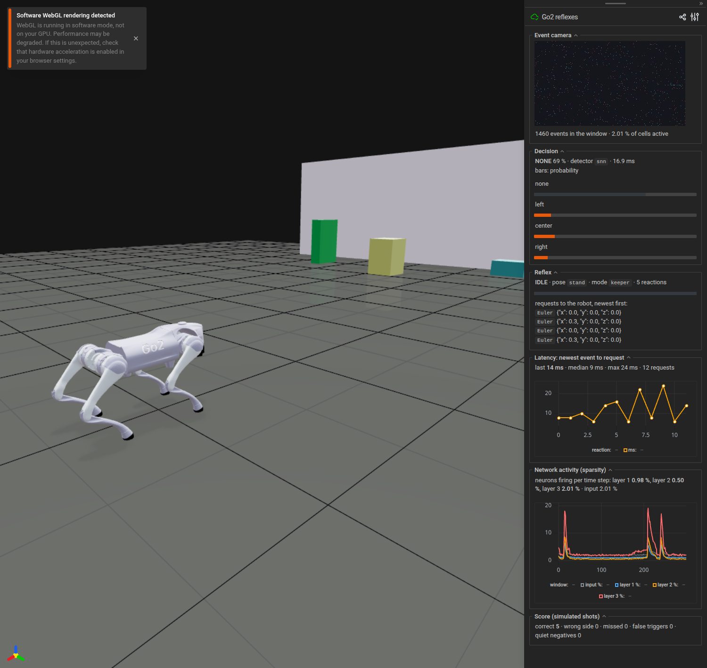

# Looking inside the ROS 2 system

Two terminals, both in the repository root.

**Terminal 1** runs the system (simulator, perception, behavior):

```bash
pixi run -e ros ros-sim
```

**Terminal 2** is for looking:

```bash
pixi run -e ros ros-shell      # a shell with ROS 2 and this workspace ready
```

## The graph

```
                 /reflex/events_window          /reflex/decision          /api/sport/request
 go2_sim_bridge ----------------------> reflex_perception ---------> reflex_behavior ---------+
      ^   (EventWindow, 50 Hz sim time)      (ReflexDecision)      (unitree_api/Request)     |
      +--------------------------------------------------------------------------------------+
```

On the real robot the bridge is replaced by two things: a camera adapter that publishes
`/reflex/events_window`, and the Go2 itself listening on `/api/sport/request`.

`rqt_graph` draws this live:

```bash
pixi run -e ros rqt_graph
```

Camera side on a Kria KV260 (`event_camera_webcam`, `reflex_perception`), robot side on
the PC (`reflex_behavior`, `go2_sim_bridge`), 19 Nov 2026. The graph does not show which
machine a node runs on.

Nodes only:



Nodes and topics (`Nodes/Topics (all)` in the drop-down):



In the drop-down, `Nodes only` shows nodes joined by topic names; `Nodes/Topics (all)`
draws topics as boxes. Untick `Debug` to see `/rosout` and `/parameter_events`. The
refresh button redraws after nodes start or stop.

## Commands

| What you want to see | Command |
|---|---|
| Which nodes are running | `ros2 node list` |
| Which topics exist and their types | `ros2 topic list -t` |
| The node/topic graph | `rqt_graph` |
| What the model outputs | `ros2 topic echo /reflex/decision` |
| Only the threats | `ros2 topic echo /reflex/decision --filter "m.label != 'none'"` |
| What the camera side sends (without the big array) | `ros2 topic echo /reflex/events_window --no-arr` |
| The events as a picture | `ros2 run rqt_image_view rqt_image_view /reflex/debug/events_image` |
| What is sent to the dog | `ros2 topic echo /api/sport/request` |
| The score of each shot | `ros2 topic echo /reflex/sim/outcome` |
| How often a topic publishes | `ros2 topic hz /reflex/decision` |
| Who publishes and who listens | `ros2 topic info /api/sport/request -v` |
| A message definition | `ros2 interface show reflex_msgs/msg/ReflexDecision` |
| A node's parameters | `ros2 param list /reflex_behavior` |

## What the messages mean

`/reflex/events_window` (`reflex_msgs/EventWindow`): the network's input. The last 50 ms
of events, as counts in 10 time steps x 2 polarities x 45 x 80 cells (72000 bytes).
`header.stamp` is the time of the newest event.

`/reflex/decision` (`reflex_msgs/ReflexDecision`): the detector's answer for one window.

```
label: none            # none / left / center / right, in the dog frame
confidence: 0.736      # 0..1 (softmax probability for the SNN)
detector: snn          # snn or simple
inference_ms: 8.9      # wall time spent in the detector
```

`/api/sport/request` (`unitree_api/Request`): the command to the Go2.
`header.identity.api_id` selects the command (see `reflex/runtime/sport_api.py`),
`parameter` is a JSON string, and `header.identity.id` carries the timestamp (µs) of the
newest event behind the decision, for latency measurements.

Most decisions are `none`: the behavior node only sends a request after two agreeing,
confident threats in a row.

Times are simulated time (`/clock`). The simulation runs slower than real time, so
`ros2 topic hz` shows about 25 Hz of wall time for a topic published at 50 Hz of
simulated time.

## Dashboard in the browser

```bash
pixi run -e ros ros-web            # then open http://localhost:8080
pixi run -e ros ros-web port:=8081
```

Start it next to any launch file, on any machine of the ROS 2 network; other devices on
the network can open `http://<pc-address>:8080`. It only listens, so it changes nothing
in the loop. Built on [viser](https://viser.studio), the library behind mjlab's browser
viewer.



| Panel | Shows | Topic |
|---|---|---|
| 3D scene | dog, ball, walker and clutter; drag to orbit, scroll to zoom | `/reflex/sim/state` |
| Event camera | events as a picture, events in the window | `/reflex/debug/events_image` |
| Decision | label, confidence, inference time, one bar per class | `/reflex/debug/perception`, `/reflex/decision` |
| Reflex | state (idle, reacting, refractory), pose, last requests | `/reflex/debug/behavior`, `/api/sport/request` |
| Latency | newest event to request, every request and the median | `/reflex/debug/latency_ms` |
| Network activity | share of neurons firing per time step, per layer, over the last 300 windows | `/reflex/debug/perception` |
| Score | outcome of every simulated shot | `/reflex/sim/outcome` |

How the 3D scene works: the simulation is not in the browser. The bridge sends the
position and orientation of each body about 30 times a second (16 bodies, 113 numbers),
and the page moves meshes it received once. `reflex/viz/web_scene.py` turns the MuJoCo
model into those meshes.

Limits:

- **Real robot:** the 3D scene stays idle, there is no simulator to send poses. Every
  other panel works. Latency is then measured with this machine's clock, so the machines
  need synchronized clocks (NTP).
- **Simple detector:** it has no neurons; the network panel shows input activity only and
  the bars show events over threshold instead of probabilities.
- **Scenery colours** match the simulator only if both use the same `seed` (default 0).
- The floor is a grid, not MuJoCo's checker texture.
- Checked with the simulated loop (`ros-sim`) in a headless browser. Not yet tried with
  the Kria as the camera or with `ros-drive`.
- The debug topics are published only while someone subscribes to them.
